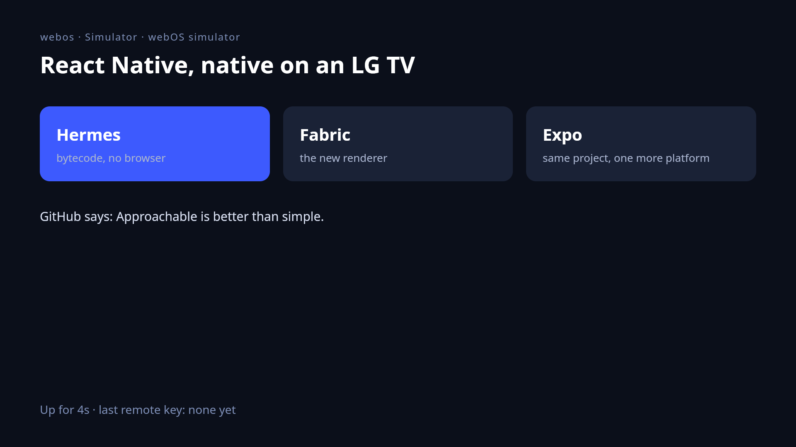

<p align="center">
  <picture>
    <source media="(prefers-color-scheme: dark)" srcset="https://raw.githubusercontent.com/kromatv/react-native-tv/main/packages/react-native-webos/docs/assets/wordmark-dark.svg">
    
  </picture>
</p>

<p align="center">
  React Native and Expo apps on LG webOS TVs, running natively on Hermes and Fabric.
</p>

<p align="center">
  <a href="https://www.npmjs.com/package/@kromatv/react-native-webos"></a>
  <a href="https://github.com/kromatv/react-native-tv/actions/workflows/ci.yml"></a>
  <a href="https://sonarcloud.io/summary/new_code?id=kromatv_react-native-webos"></a>
  <a href="https://sonarcloud.io/component_measures?id=kromatv_react-native-webos&metric=coverage"></a>
  <a href="LICENSE"></a>
  <br>
  
  
  
</p>

<p align="center">
  
  <br>
  <sub>The example app in the simulator, captured with <code>rn-webos simulator screenshot</code>.</sub>
</p>

> **An alpha, run on two LG TVs.** The example and one production app ran on
> TVs of LG's Cloud Test Lab, webOS 24 and webOS 25
> ([what ran](docs/reference/hardware-verification.md)). Everything else was
> checked in the [simulator](simulator/README.md), and no TV in Developer Mode
> has run it: see [Status](#status).

## Why

LG's developer site documents web apps only, so a React Native app reaches an
LG TV today through react-native-web, which renders it to the DOM in the TV's
browser engine. That is a second renderer, with its own layout, input
and performance, to build and test for.

react-native-webos runs the app the way Android and iOS run it. The package
holds one native executable, `react-native-webos`: Hermes, React Native's C++
core (Fabric, TurboModules, Yoga) and a host that draws with Skia on OpenGL ES.
Your JavaScript ships as Hermes bytecode. There is no browser and no WebView in
the process.

For an Expo app, webOS is one more platform. The same project and the same
`app.json` build for it, and `Platform.OS` is `'webos'`.

It is the sibling of
[react-native-tizen](https://github.com/kromatv/react-native-tv/tree/main/packages/react-native-tizen), which does
the same for Samsung TVs, and shares its CLI design, its React Native and Expo
integration and its simulator.

## Features

- **Expo integration.** `npx expo install` adds the config plugin, and
  `npx expo start` opens the app on the TV with `t`, and lists Run on TV, Run
  in simulator, Find TVs and Connect TV under shift+m.
- **Development builds.** Fast Refresh, `r` to reload, `console.log` in the
  Expo terminal, LogBox on the TV, and React Native DevTools on the TV's Hermes
  with `j`. `rn-webos screenshot` saves what a development build draws.
- **The remote, as on Apple TV.** `useTVEventHandler` gets one event per
  press, a key held for 300 ms sends `longSelect` or `longUp`, and Back reaches
  `BackHandler`.
- **The Magic Remote's pointer.** It is a mouse: `Pressable` gets `onHoverIn`,
  `onHoverOut` and presses, and the wheel scrolls the scroll view under it.
- **Video.** `expo-video` plays on the TV's media pipeline, under the app's
  window, with audio and subtitle track selection.
- **Expo modules.** `expo-image`, `expo-video`, `expo-file-system`,
  `expo-font`, `expo-blur`, `expo-device`, `expo-constants`, `expo-keep-awake`
  and `expo/fetch` have webOS implementations.
- **Native libraries.** A library with a `codegenConfig` compiles into the
  runtime. react-native-svg ships with a webOS implementation.
- **`Intl`.** ICU 78.3 is compiled in, with its data trimmed to the locales you
  list.
- **Its own HTTPS.** libcurl and Mbed TLS are compiled in with Mozilla's root
  certificates, so TLS does not depend on the age of the TV's firmware.
- **No LG tools.** `rn-webos` reaches the TV over SSH itself, writes the
  `.ipk` in TypeScript and finds TVs on the network. `ares-*` is never run, and
  a package is not signed. The same code is a Node API.
- **A simulator.** The same runtime, built for aarch64 Linux, runs in a VM on
  an Apple silicon Mac, with a live screen, screenshots, remote keys, the
  pointer and native backtraces. LG's own simulator runs web apps only.

## Quick start

### 1. Install the tools

macOS on Apple silicon is the only build host tried so far.

- [Node.js](https://nodejs.org) 22.13 or newer, which runs the CLI and Expo.
- LLVM, CMake and Ninja, which cross-compile the runtime:

  ```sh
  brew install llvm lld cmake ninja ccache
  ```

- Xcode's command line tools (`xcode-select --install`): git, Python 3 and the
  compiler that builds the build's own tools.

The SDK the runtime compiles against (openlgtv's, a sysroot older than any
TV's) is downloaded by `rn-webos` on the first build. Nothing from LG is
installed on the computer.

### 2. Put the TV in Developer Mode

1. On the TV, install the **Developer Mode** app from LG's store and sign in
   with an LG developer account.
2. Turn **Dev Mode Status** on. The TV restarts.
3. Open the app again and turn **Key Server** on. Note the passphrase it
   shows.

### 3. Add the package

In an Expo SDK 58 app:

```sh
npx expo install @kromatv/react-native-webos
npx rn-webos init
```

`init` asks for the app's webOS id, writes `metro.config.mjs` (or wraps the
one you have with `withTV`), points `react-native` at
[react-native-tvos](https://github.com/react-native-tvos/react-native-tvos),
the TV fork of React Native this package is built against, and runs your
package manager's install. Running it again changes nothing. With Bun, pnpm or
Yarn, run `rn-webos` with `bunx`, `pnpm exec` or `yarn`.

`withTV` teaches Metro every TV platform the app depends on, so an app that
also runs on Samsung TVs with
[`@kromatv/react-native-tizen`](https://github.com/kromatv/react-native-tv/tree/main/packages/react-native-tizen)
keeps one call in its Metro config, whichever of the two packages it imports
`withTV` from:

```js
import { getDefaultConfig } from 'expo/metro-config';
import { withTV } from '@kromatv/react-native-webos/metro';
export default withTV(getDefaultConfig(import.meta.dirname));
```

### 4. Connect the TV, once

```sh
npx rn-webos devices                 # the LG TVs on your network
npx rn-webos connect 192.168.1.50    # asks for the passphrase
```

`connect` fetches the TV's SSH key from its key server and keeps it for the
other commands. Key Server can be turned off again afterwards.

### 5. Run it from `expo start`

```sh
npx expo start
```

Press **t**, as you press `a` for Android. The app opens on the TV you used
last: a development build that loads its JavaScript from the dev server, with
Fast Refresh and its logs in this terminal. **shift+t** picks another TV or
the simulator.

The first run builds the native runtime, which takes several minutes; later
runs rebuild only what changed. `npx rn-webos doctor` names the fix for
anything a build needs.

To package the app with its JavaScript inside:

```sh
npx rn-webos package        # webos/<id>_<version>_arm.ipk, a release build
npx rn-webos run            # package, install, launch, print the logs
```

### Without a TV

```sh
brew install lima
npx rn-webos simulator run --gui
```

runs the app on a virtual TV on the Mac and opens its live screen and a remote
in the browser. See [the simulator](simulator/README.md).

A real TV can also be reached over the internet: LG's webOS Cloud Test Lab in
Seller Lounge shows an uploaded package running on a TV in Korea, and TV Labs
rents sessions on LG TVs that `rn-webos` can install to through a tunnel
([reference](docs/reference/webos-tv-platform.md#14-a-real-tv-without-owning-one)).
The Cloud Test Lab is how this package first ran on a TV
([what ran](docs/reference/hardware-verification.md)); TV Labs has not been tried.

## Examples

The [example app](example/) has a screen for each.

### Remote keys

```tsx
import { useEffect, useState } from 'react';
import { BackHandler, Text, useTVEventHandler } from 'react-native';

export function LastKey() {
  const [key, setKey] = useState('none');
  useTVEventHandler((event) => setKey(event.eventType));
  useEffect(() => {
    const subscription = BackHandler.addEventListener('hardwareBackPress', () => {
      setKey('back');
      return true;
    });
    return () => subscription.remove();
  }, []);
  return <Text>{`Last key: ${key}`}</Text>;
}
```

`eventType` is `up`, `down`, `left`, `right`, `select`, `playPause`,
`fastForward`, `rewind`, a digit, a color key, or `long<Key>` for a hold.

### The pointer

```tsx
import { useState } from 'react';
import { Pressable, Text } from 'react-native';

export function Card({ title, onOpen }: { title: string; onOpen: () => void }) {
  const [hovered, setHovered] = useState(false);
  return (
    <Pressable
      onHoverIn={() => setHovered(true)}
      onHoverOut={() => setHovered(false)}
      onPress={onOpen}
      style={{ padding: 24, borderRadius: 12, backgroundColor: hovered ? '#3d5afe' : '#1b2233' }}
    >
      <Text style={{ color: '#fff', fontSize: 32 }}>{title}</Text>
    </Pressable>
  );
}
```

### Video

```tsx
import { useVideoPlayer, VideoView } from 'expo-video';
import { useTVEventHandler } from 'react-native';

export function Player({ uri }: { uri: string }) {
  const player = useVideoPlayer(uri, (created) => created.play());
  useTVEventHandler((event) => {
    if (event.eventType === 'playPause') {
      if (player.playing) player.pause();
      else player.play();
    }
    if (event.eventType === 'fastForward') player.seekBy(30);
    if (event.eventType === 'rewind') player.seekBy(-10);
  });
  return <VideoView player={player} contentFit="contain" style={{ flex: 1 }} />;
}
```

The TV draws video on its own plane, under the UI. What `expo-video` does on
webOS, call by call, is in
[the media reference](docs/reference/webos-media-playback.md).

## Status

This is an alpha. It has run on two TVs in LG's Cloud Test Lab, webOS 24 and
webOS 25, and never on one in Developer Mode:
[what ran, on which TV](docs/reference/hardware-verification.md).
What stands behind each part:

| Part | Evidence so far |
|---|---|
| The runtime: Hermes, Fabric, views, text, images, `TextInput`, remote keys, the pointer, Expo modules, react-native-svg | Runs in the simulator, the same source built for aarch64 Linux; 1008 C++ tests. The example's screens ran on a webOS 25 TV |
| The TV executable | Cross-compiles on a Mac; its imports resolve on the firmware images of 14 releases, webOS 1.2 to 11.2 (`scripts/check-tv-binary.ts`). Starts on a webOS 25 TV |
| The window, input and lifecycle on a TV | Written from SDL's webOS port and LG's and webOS OSE's sources; the simulator uses X11 instead. On a webOS 25 TV: the window, the remote with long presses, Back, relaunch, the pointer, the wheel and the on-screen keyboard |
| Video | The player logic has tests against a fake of the TV's media service. On a webOS 25 TV: HLS and Matroska H.264 play, in a box and fullscreen, with audio and subtitle tracks, pause and seek. HEVC, HDR and DRM were not tried there with the example |
| `connect`, `install`, `run`, `key`, `logs` | Tests against a fake TV. Never run against a real one |
| Publishing to LG's store | Not submitted. Seller Lounge's upload form took the package as a Native file, registered per chipset, and saved it as a draft; LG's guide reserves native files for sellers with a contract ([reference](docs/reference/webos-tv-platform.md#12-who-may-publish-a-native-app)) |

Known gaps:

- No native focus engine: `focusable`, `hasTVPreferredFocus` and
  `TVFocusGuideView` do nothing. Keep the focused item in state and move it on
  remote events.
- The floor is webOS TV 4 (2018 models). Earlier releases set the permissions
  of an app's directory wrong.
- One `VideoPlayer` loads at a time, since a TV showed no picture for a video
  loaded beside another. The player a view shows goes first: a player no view
  shows reports `loading` until then, so it cannot preload behind a video on
  screen, and the one it replaces loads again where it was when it is shown
  again.
- `expo prebuild`, `expo export --platform webos` and `expo run:webos` do not
  exist: Expo's CLI has no way to add a platform. `rn-webos package` and
  `rn-webos run` stand in.

Measured in the simulator, on a software GPU, so only good for comparing one
change with another ([docs/benchmarks.md](docs/benchmarks.md)): the example's
1,000-row list scrolls at 60 frames a second with none dropped, and a release
package of the example is 9.3 MB.

## Documentation

- [The `rn-webos` CLI](docs/cli.md): every command and option, the config
  plugin's props, `expo start`, where builds land
- [The simulator](simulator/README.md): a virtual TV on an Apple silicon Mac
- [The `webos` Node API](docs/webos-api.md): find TVs, install and launch from
  your own tools
- [Runtime config](docs/runtime-config.md): what the runtime reads at startup
- [Native libraries and Expo modules](docs/native-modules.md): what compiles
  into the runtime, and how a library adds webOS support
- [Design decisions](docs/decisions.md): what the package is built on, and why
- [The platform reference](docs/reference/README.md), with a source for every
  fact:
  [the TV platform](docs/reference/webos-tv-platform.md),
  [the toolchain](docs/reference/webos-native-toolchain.md),
  [the window and input](docs/reference/webos-window-input.md),
  [Skia rendering](docs/reference/skia-rendering.md),
  [media playback](docs/reference/webos-media-playback.md),
  [the device protocol](docs/reference/webos-device-protocol.md),
  [the `.ipk` format](docs/reference/webos-ipk-format.md),
  [the remote control service](docs/reference/webos-remote-control.md),
  [TV discovery](docs/reference/tv-discovery.md)
- [Benchmarks](docs/benchmarks.md)
- [Contributing](CONTRIBUTING.md), [security policy](SECURITY.md),
  [third-party notices](THIRD_PARTY_NOTICES.md)

## Licence

MIT. What the runtime and the packages it builds carry from other projects,
and under which licences, is in [`THIRD_PARTY_NOTICES.md`](THIRD_PARTY_NOTICES.md).

Not affiliated with or endorsed by LG Electronics, Meta or Expo. LG, webOS,
Magic Remote, React Native and Expo are trademarks of their owners.
